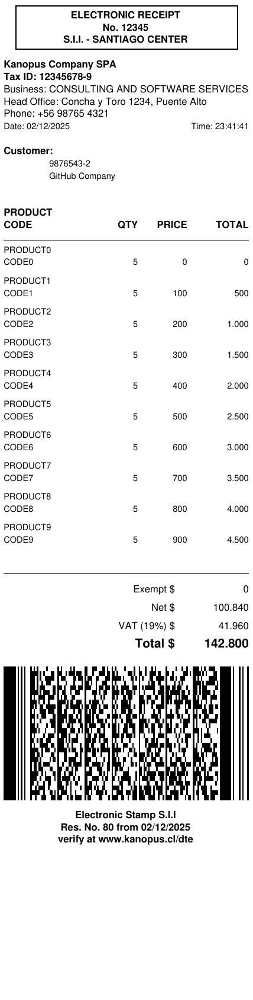

<p style="text-align:left">
  
</p>

  

# klib-pdf

This project is designed as a utility that allows you to generate PDF files in an easier way.

## ✨ Features

- It allows you to generate PDF in a special 80mm format for thermal printers.
- It allows you to generate PDF in a special 58mm format for thermal printers.
- Allows you to print PDF417 stamp
- Built on [OpenPDF](https://github.com/LibrePDF/OpenPDF) (LGPL-2.1 / MPL-2.0); embeds the bundled Liberation Sans
  font so any Unicode text (ñ, á, €, Ω, Cyrillic, Greek…) renders correctly.

## 🚀 Installation

Add the dependency to your `pom.xml`:

```xml

<dependency>
	<groupId>cl.kanopus.util</groupId>
	<artifactId>klib-pdf</artifactId>
	<version>4.20.0</version>
</dependency>
```

---

## 🚀 Usage Guide

1. Creating a PDF

```java
// Full example based on the test class Receipt80mmPDF
// filepath: src/test/java/cl/kanopus/pdf/thermal/Receipt80mmPDF.java
package cl.kanopus.pdf.thermal;

import cl.kanopus.common.util.Utils;
import cl.kanopus.pdf.DocumentPrinterException;
import cl.kanopus.pdf.FontFamily;
import java.awt.Color;

import java.io.ByteArrayOutputStream;
import java.util.Date;

public class Receipt80mmPDF extends AbstractPrint80mm {

    public Receipt80mmPDF() throws DocumentPrinterException {
        super(calcularHeight(10));
    }

    public ByteArrayOutputStream generateOutput() throws Exception {

        //HEADER
        drawRectangle(13, getPositionY() + Space.LOW.size, 180, 35, Color.BLACK, 1);
        println("ELECTRONIC RECEIPT", Align.CENTER);
        println("No. 12345", Align.CENTER);
        println("S.I.I. - SANTIAGO CENTER", Align.CENTER);
        setPositionY(getPositionY() - Space.LOW.size);


        //COMPANY INFO
        setFont(FontFamily.FONT_8_BLACK_BOLD);
        setSpace(Space.LOW);
        println("Kanopus Company SPA");
        println("Tax ID: 12345678-9");

        setFont(FontFamily.FONT_8_BLACK_NORMAL);
        printSplit("Business: CONSULTING AND SOFTWARE SERVICES", 42);
        printSplit("Head Office: Concha y Toro 1234, Puente Alto", 45);
        println("Phone: +56 98765 4321");

        setFont(FontFamily.FONT_7_BLACK_NORMAL);
        print("Date: " + Utils.getDateFormat(new Date()), Align.LEFT);
        println("Time: " + Utils.getTimeFormat(new Date()), Align.RIGHT);
        setPositionY(getPositionY() - Space.LOW.size);

        //RECIPIENT
        setFont(FontFamily.FONT_8_BLACK_BOLD);
        setSpace(Space.LOW);
        println("Customer:");

        setFont(FontFamily.FONT_7_BLACK_NORMAL);
        println("9876543-2", 40);
        println("GitHub Company", 40);

        setPositionY(getPositionY() - Space.LOW.size);

        /*
         * **************** ITEMS ***********************
         * *************************************************
         */
        setPositionY(getPositionY() - Space.LOW.size);
        setFont(FontFamily.FONT_8_BLACK_BOLD);
        setSpace(Space.LOW);
        println("PRODUCT");
        print("CODE");
        print("QTY", getPageWidth() - getMarginRight() - 90, Align.RIGHT);
        print("PRICE", getPageWidth() - getMarginRight() - 50, Align.RIGHT);
        println("TOTAL", Align.RIGHT);

        printLine();
        setFont(FontFamily.FONT_7_BLACK_NORMAL);
        // Now let's loop over the screenings
        for (int i = 0; i < 10; i++) {
            setSpace(Space.LOW);
            println("PRODUCT" + i);
            setSpace(Space.NORMAL);
            print("CODE" + i);
            print(Utils.getNumberFormat(5), getPageWidth() - getMarginRight() - 90, Align.RIGHT);
            print(Utils.getNumberFormat(100 * i), getPageWidth() - getMarginRight() - 50, Align.RIGHT);
            println(Utils.getNumberFormat(5 * 100 * i), Align.RIGHT);
        }


        /*
         * *************** TOTALS SECTION *****************
         * ************************************************
         */
        setFont(FontFamily.FONT_8_BLACK_NORMAL);
        setPositionY(getPositionY() - Space.LOW.size);
        printLine();
        print("Exempt $", getPageWidth() - getMarginRight() - 60, Align.RIGHT);
        println(Utils.getNumberFormat(0), Align.RIGHT);

        print("Net $", getPageWidth() - getMarginRight() - 60, Align.RIGHT);
        println(Utils.getNumberFormat(100840), Align.RIGHT);

        print("VAT (19%) $", getPageWidth() - getMarginRight() - 60, Align.RIGHT);
        println(Utils.getNumberFormat(41960), Align.RIGHT);

        setFont(FontFamily.FONT_10_BLACK_BOLD);
        print("Total $", getPageWidth() - getMarginRight() - 60, Align.RIGHT);
        println(Utils.getNumberFormat(142800), Align.RIGHT);

        /*
         * ************ ELECTRONIC STAMP *****************
         * ***********************************************
         */

        printPdf417("PDF417|TYPE:ELECTRONIC_RECEIPT|NO:12345|TAX_ID:12345678-9|DATE:2025-12-03|TIME:12:00|NET:100840|VAT:41960|TOTAL:142800|VERIFY:www.kanopus.cl/dte");


        setSpace(Space.LOW);
        setFont(FontFamily.FONT_8_BLACK_BOLD);
        println("Electronic Stamp S.I.I", Align.CENTER);
        println("Res. No. 80 from " + Utils.getDateFormat(new Date()), Align.CENTER);
        println("verify at www.kanopus.cl/dte", Align.CENTER);
        println("");
        return super.close();
    }

}
```

You can also run the provided tests (`mvn verify`); the generated PDFs are written to `target/test-output/`
(e.g. `receipt-80mm.pdf`). The resulting sample output is shown below:


## ⚠️ Breaking changes in 4.20.0 — iText 5 replaced by OpenPDF

Before 4.20.0 this library depended on `com.itextpdf:itextpdf:5.5.13.x`, which is **AGPL-3.0** licensed and end-of-life,
while klib-pdf itself is published under Apache-2.0. Since 4.20.0 it depends on
**`com.github.librepdf:openpdf:3.0.5`** (dual LGPL-2.1 / MPL-2.0), which is compatible with using klib-pdf in
Apache-2.0 / proprietary applications. OpenPDF 3.x requires Java 21 and uses the `org.openpdf` packages (3.0.5 was
chosen over 3.0.6 because the latter had just been released when this version was prepared).

Types from the PDF engine are part of the public API (`PDFTable extends PdfPTable`, `Font`, `Image`,
`PdfContentByte getCanvas()`, `PdfNumber` orientation…), so consumers must update their imports:

| Before (iText 5)                          | After (OpenPDF 3)                          |
|-------------------------------------------|--------------------------------------------|
| `com.itextpdf.text.*`                     | `org.openpdf.text.*`                       |
| `com.itextpdf.text.pdf.*`                 | `org.openpdf.text.pdf.*`                   |
| `com.itextpdf.text.pdf.draw.LineSeparator`| `org.openpdf.text.pdf.draw.LineSeparator`  |
| `com.itextpdf.text.BaseColor`             | `java.awt.Color` (e.g. `drawRectangle(..., Color.BLACK, 1)`) |
| `PdfTextExtractor.getTextFromPage(reader, n)` | `new PdfTextExtractor(reader).getTextFromPage(n)` |

`DocumentException` is unchecked in OpenPDF; if your code only caught it you can drop the `catch`. If you add the
iText dependency yourself, remove it.

### Other behavior changes in 4.20.0

- **Fonts:** `FontFamily` fonts no longer fall back to the non-embedded Helvetica/CP1252 font (the "arial" name was
  never registered). They use the bundled **Liberation Sans** (SIL OFL 1.1, metric compatible with Arial/Helvetica,
  license in `cl/kanopus/pdf/fonts/LICENSE-LiberationSans.txt`) embedded as a subset with `Identity-H`, so the PDFs are
  slightly larger but render any Unicode text. Bold/italic come from the real font files; `Font.getStyle()` of the
  constants therefore reports `NORMAL`.
- **`FontFamily` constants are unmodifiable** (they are shared between threads): their setters throw
  `UnsupportedOperationException`. Use `FontFamily.font(size, style, color)` or `new Font(FontFamily.FONT_…)` to get a
  mutable copy.
- **`AbstractPaginatorPDF`:** the footer was drawn after `newPage()` (page 1 had none, the last page had it twice). It
  is now printed exactly once per page when `alwaysPrintFooter` is true, and only on the last page otherwise. A page
  `limit <= 0` throws `IllegalArgumentException` (it used to fail with `ArithmeticException`), a `null` list is treated
  as empty, the page number is right-aligned to `getPageWidth() - 25`, and the document is closed when generation fails.
- **Page geometry:** `getPageWidth()/getPageHeight()` return the size given to the protected constructor (they always
  returned the 21x33 cm constants). `getMarginLeft()/getMarginRight()` still default to `MARGIN_LEFT/RIGHT` and can be
  changed with the new `setTextMargins(left, right)`; `printLine()` uses them. Page rotation (`PdfPage.LANDSCAPE`…) is
  applied through the page size; the `Rotate` page event is deprecated and does nothing.
- **PDF417:** `printPdf417(...)` encodes the content as ISO-8859-1 when possible (unchanged output, as required by the
  SII stamp) and as UTF-8 with an ECI marker otherwise (non-Latin-1 characters were silently replaced by `?`). New
  overloads accept an explicit `Charset` and throw `DocumentPrinterException` if the text cannot be represented. On
  normal pages the Y position after the barcode now uses the *scaled* height. Error messages say "PDF417"/"Code39"
  instead of "barcode39". Barcode rendering is shared in the new `cl.kanopus.pdf.Barcodes` class.
- **Thermal printers:** `println(null)` now advances the line like the normal printer; a `null` `Align` means `LEFT`
  for text and `CENTER` for lines; `setFont(null)` restores the default font.
- `close()` is idempotent and `closeQuietly()` was added; `null` texts in `printAbsolute` and `null` colors in
  `drawRectangle*` are ignored / default to black.

## 👤 Author

⭐**Pablo Andrés Díaz Saavedra** — Founder of **Kanopus – Software Guided by the Stars**⭐

Kanopus is building a constellation of developers creating tools, libraries and platforms that simplify software
engineering.

[GitHub](https://github.com/godheaven) | [LinkedIn](https://www.linkedin.com/in/pablo-diaz-saavedra-4b7b0522/) | [Website](https://kanopus.cl)

## 📄 License

This software is licensed under the Apache License, Version 2.0. See the LICENSE file for details.
Since 4.20.0 its runtime dependencies are Apache-compatible: OpenPDF (LGPL-2.1 / MPL-2.0), ZXing (Apache-2.0) and the
bundled Liberation Sans fonts (SIL Open Font License 1.1).
I hope you enjoy it.

[](https://opensource.org/license/apache-2-0)

## 🛟 Support

For support or questions contact: 📧 [soporte@kanopus.cl](mailto:soporte@kanopus.cl)
